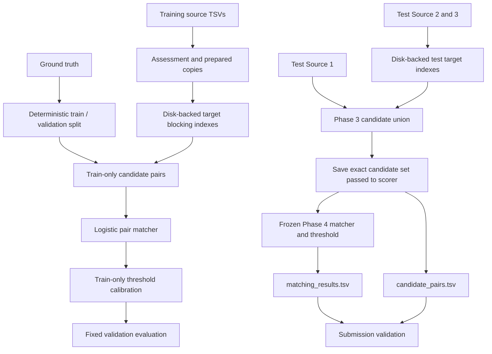

# Business Entity Resolution — ML Challenge 2026

## Project overview

This project matches business records across three independent data sources. Source 1 is the reference set: for every Source 1 business, the system must return zero or more matching records from Source 2 and Source 3. The sources have no shared identifiers, and names, addresses, and country fields can be incomplete or inconsistent.

The work builds a reproducible pipeline around four main stages:

1. Inspect and prepare the supplied TSV data.
2. Create a deterministic training/validation split and a macro F0.5 scorer.
3. Use scalable blocking to reduce the enormous cross-source pair space.
4. Train and calibrate a precision-aware pair matcher, then use the frozen pipeline for test inference.

The project uses only the supplied challenge data. It does not look up businesses in external databases, APIs, geocoding services, or other external sources.

## Problem and evaluation

For each Source 1 row, the output may contain no matches, one match, or multiple matches across Source 2 and Source 3. Empty predictions matter: singletons are included in the challenge’s macro score, and a correctly empty prediction receives full credit for that entity.

The challenge uses macro F0.5. F0.5 weights precision more heavily than recall, so a false merge is more costly than a missed link. Scores are computed per Source 1 entity and averaged over the complete evaluation population, including singletons.

The training tables contain `entity_id`, `business_name`, `business_address`, and `country`. IDs identify the source through their `S1-`, `S2-`, or `S3-` prefix. Ground truth maps each Source 1 ID to a comma-separated list of matching Source 2/3 IDs. All files are tab-separated; the ID lists use commas inside a TSV field.

Country is treated as an open set. The training data contains the countries documented in the challenge README, while test data includes France. The pipeline does not hard-code a country allow-list; country-specific exact blocks use the row’s actual country value, and token/character fallbacks remain available across countries.

## Dataset layout

The supplied project is organized as follows:

```text
student_resource/
├── dataset/
│   ├── train/
│   │   ├── train_source1.tsv
│   │   ├── train_source2.tsv
│   │   ├── train_source3.tsv
│   │   └── train_ground_truth.tsv
│   ├── test/
│   │   ├── test_source1.tsv
│   │   ├── test_source2.tsv
│   │   └── test_source3.tsv
│   ├── cleaned/train/          # compressed Phase 1 prepared copies
│   └── splits/                 # validation manifest, IDs, and metrics
├── notebooks/
│   ├── data_assessment/        # per-table assessment/cleaning notebooks
│   ├── validation/             # split, blocking, and matcher experiments
│   └── inference/              # frozen test inference and output checks
├── output/
│   ├── candidate_pairs.tsv
│   └── matching_results.tsv
├── utils/
│   └── validate_submission.py
└── Documentation_template.md
```

The supplied `README.md` is the challenge specification. This document describes the project’s implementation and workflow.

## What has been done

### Phase 1 — Data assessment and preparation

Four data-assessment notebooks inspect the three source tables and the ground-truth table. The work uses streaming TSV reads for large files and writes compressed prepared copies under `dataset/cleaned/train/`. The original challenge tables remain the reference inputs for validation, blocking, and inference. Data handling preserves source IDs and does not discard incomplete-address records simply because fields are missing.

### Phase 2 — Fixed validation split and scorer

A deterministic hash-based split holds out **441,363 Source 1 entities** for validation. The remaining **1,765,458 Source 1 entities** are available for matcher training and threshold calibration. The selected IDs and split metadata are saved under `dataset/splits/` so later experiments use the same holdout.

The metric implementation follows the challenge’s macro F0.5 definition and includes singleton entities. Threshold selection is performed on a separate, deterministic calibration subset drawn from the training partition; validation labels are used only to report final validation results.

### Phase 3 — Candidate generation / blocking

Comparing every Source 1 row with every Source 2 and Source 3 row would require an impractical number of pair comparisons. Blocking creates a smaller, high-recall candidate union before the model scores pairs.

Text normalization uses Unicode NFKC normalization, case folding, and alphanumeric tokenization. Name normalization also handles common legal suffixes and aliases; address normalization standardizes selected street terms. Exact name/address blocks include country in their key. Token and character fallbacks are country-agnostic.

The final `union_token_pairs` candidate union combines:

- Exact normalized name and address blocks.
- Canonical and unordered canonical name blocks.
- Canonical address blocks.
- Rare name and address token postings, including expanded token routes.
- Character trigram postings from selected name tokens.
- Name-token and address-token pair postings.

Posting lists larger than the configured cap are skipped to avoid high-frequency, low-information blocks. The large indexes are built in disk-backed NumPy memory maps, then sorted for fast posting lookup. Ground truth is used only for validation measurements, never to construct candidate routes.

On the fixed validation set, the final blocking union produced **75,649,390** pairs, about **171.4 candidates per Source 1 row**. It recovered **92.14% of true target links**, covered **98.88% of Source 1 entities with at least one true target**, and reduced the theoretical pair space by **99.99834%**. The per-source and route-level details are stored in `dataset/splits/phase3_blocking_metrics.json`; a deterministic missed-link sample is stored in `phase3_missed_examples.json`.

Blocking recall is the matcher’s upper bound: a true link omitted by candidate generation cannot be returned by later scoring.

### Phase 4 — Baseline learned pair matcher

The baseline matcher is an L2-regularized logistic regression implemented with NumPy. It scores a candidate pair from fourteen features:

- Twelve binary blocking-route indicators.
- Whether the target belongs to Source 3.
- A scaled `log1p` transform of the candidate-set size for that Source 1 entity.

Training uses a deterministic sample of **20,000** non-validation Source 1 queries. The sample is split into **15,941 fit queries** and **4,059 calibration queries**. All generated positive candidate pairs are retained; up to 30 deterministic candidate negatives are sampled per fit query. The threshold is chosen to maximize macro F0.5 on the calibration queries only.

The Phase 4 model achieved **0.46887 validation macro F0.5**, compared with **0.05585** for predicting no matches. Its validation micro precision was **22.40%**, and micro recall was **47.03%**. The frozen Phase 4 model weights and calibrated threshold are recorded in `dataset/splits/phase4_matcher_metrics.json`.

### Additional matcher experiment — token coverage

An additional experiment added name-token and address-token coverage features to the Phase 4 route features. Coverage measured what fraction of selected query tokens appeared in a candidate’s indexed token postings. It is a memory-bounded, asymmetric similarity proxy; it is not full Jaccard similarity, edit distance, or TF-IDF cosine.

The experiment achieved **0.46791 validation macro F0.5**, slightly below the Phase 4 baseline’s **0.46887**. Recall increased slightly while precision declined, so the Phase 4 matcher remains the selected inference model. The experiment and its measured metrics are retained separately; they do not replace the frozen Phase 4 model.

## Architecture



At inference time, candidate generation and scoring use the same Phase 3 routes and Phase 4 feature order, learned weights, and calibrated probability threshold as the fixed validation run. The candidate output records the final deduplicated union immediately before scoring; every emitted match is selected from that same in-memory candidate list.

## End-to-end workflow

1. Read TSVs using the tab delimiter and preserve all input identifiers.
2. Assess the data and produce prepared compressed copies for inspection.
3. Create or reuse the fixed validation IDs and keep those IDs out of model fitting and threshold selection.
4. Build target-side blocking indexes from Source 2 and Source 3.
5. Generate per-query candidate unions and derive route-indicator feature rows.
6. Fit the pairwise logistic model on deterministic training queries and their labeled candidate pairs.
7. Select the probability threshold using disjoint training-only calibration queries.
8. Evaluate once on the fixed validation set, including singleton Source 1 entities.
9. For test inference, rebuild the same indexes over test Source 2/3, block every test Source 1 row, write the candidate set passed to the scorer, score those candidates using the frozen Phase 4 model, and write the selected matches.
10. Validate output coverage, IDs, duplicates, and the candidate-subset condition.

## Reproducing the work

### Environment

The implementation uses Python’s standard library plus NumPy. It does not require pandas, scikit-learn, SciPy, a database, an external model service, or internet access. Use a Python version supported by the supplied `utils/validate_submission.py` (Python 3.8 or newer) and install a compatible NumPy release if it is not already available.

The indexes are several gigabytes on disk and use NumPy memory-mapped files under `dataset/splits/` while each full-data run is active. Ensure the workspace has enough free disk space. Temporary indexes are removed after successful completion.

### Run validation experiments

Run commands from the project root. The notebooks document the experiment and execute the associated script.

```bash
python notebooks/validation/phase3_blocking_benchmark.py
python notebooks/validation/phase4_pairwise_matcher.py
```

Phase 2 split creation is documented in `notebooks/validation/phase2_validation_setup.ipynb`. The additional token-coverage experiment can be rerun with:

```bash
python notebooks/validation/phase5_similarity_matcher.py
```

The token-coverage run writes `dataset/splits/phase5_similarity_matcher_metrics.json`; it is an experiment, not the selected test inference model.

### Run test inference

The test inference script loads the frozen Phase 4 metrics, builds test indexes from `dataset/test/test_source2.tsv` and `test_source3.tsv`, and processes every row in `test_source1.tsv`:

```bash
python notebooks/inference/phase5_test_inference.py
```

It writes these required files under `output/`:

- `candidate_pairs.tsv`: the exact deduplicated candidate IDs passed to the matcher for each Source 1 entity.
- `matching_results.tsv`: the frozen matcher’s selected candidate IDs; every prediction is drawn from the corresponding candidate row.

Each file has one row per test Source 1 entity, in source-file order. Empty candidate and match lists are represented by an empty second TSV field. Test target IDs use variable-length numeric suffixes; the inference script checks that the integer-packed representation is lossless and reconstructs IDs without adding zero padding.

The full test inference run processed **1,732,544** Source 1 records against **9,969,589** Source 2/3 targets. It wrote **307,033,596** candidate pairs and **12,531,141** predicted matches. There were **465** rows with no blocking candidates and **137,474** rows with no predicted matches. The streaming validator passed: every Source 1 ID appears exactly once and in source order, all referenced target IDs exist in the test files, neither ID list has duplicates, and every final match is in its candidate set.

### Validate outputs

The provided validator checks file headers, required Source 1 coverage, duplicate rows and IDs, source prefixes, and whether matches appear in candidates:

```bash
python utils/validate_submission.py \
  --matching output/matching_results.tsv \
  --candidate output/candidate_pairs.tsv \
  --test-dir dataset/test
```

The optional `--check-ids` mode loads all target record IDs into memory and may require several GB of RAM for this test set. The default subset check streams aligned output rows without retaining the multi-gigabyte candidate map. `notebooks/inference/validate_phase5_outputs.py` provides a streaming alternative that checks target existence through a disk-backed sorted ID index as well as coverage, duplicates, and the candidate-subset rule:

```bash
python notebooks/inference/validate_phase5_outputs.py
```

## Results and known limitations

- **Validation macro F0.5:** 0.46887 for the selected Phase 4 baseline.
- **Validation candidate recall:** 92.14%, which caps achievable recall for this candidate generator.
- **Validation candidate count:** 75,649,390 pairs across 441,363 Source 1 queries.
- **Validation candidate positive-entity coverage:** 98.88%.
- **Validation reduction ratio:** 99.99834% of the theoretical cross-source pair universe eliminated.
- The current pair model uses blocking evidence rather than detailed name/address edit distance or TF-IDF features. The tested token-coverage proxy did not improve validation macro F0.5.
- Address quality and transliteration variation remain significant sources of missed links. The Phase 3 missed-link sample supports further investigation of richer, symmetric name/address similarities and source-specific calibration.
- Test ground truth is unavailable, so test outputs have no direct score. Validation metrics are the performance estimate; they should not be represented as test-set accuracy.

## Challenge compliance and packaging

The project follows the challenge’s no-external-lookup rule and uses only the provided data. The matcher is a small NumPy logistic regression rather than a pretrained language model, so the challenge’s model size/license constraint does not apply to a third-party pretrained model.

The final challenge archive is assembled as `business_entity_resolution_submission.zip`. It contains the two output TSVs, a runnable copy of the source scripts under `code/business_entity_resolution/src/`, the methodology document, and pinned NumPy requirements. The archive does not include the challenge dataset; the organizer-provided `dataset/train/` and `dataset/test/` folders must be supplied beside the extracted package to reproduce training and inference. The package README documents the exact working-directory assumptions and commands.

The working repository also keeps development notebooks and scripts under `notebooks/`, and the submission copy under `submission_package/`. The submission copy is intentionally self-contained for code and outputs, while the input data remains external under the challenge's distribution rules.

## Quality checks performed

- The official challenge validator passed against the final `output/matching_results.tsv` and `output/candidate_pairs.tsv` files.
- The disk-backed inference validator passed full Source 1 coverage and ordering, target-ID existence, duplicate checks, and the requirement that every predicted match be present in the corresponding saved candidate set.
- Eight synthetic inference edge cases pass, covering normalization, suffix-only names, aliases, malformed and out-of-range IDs, posting-list caps, blank-field route suppression, and empty feature matrices.
- Three streaming-validator unit checks pass, covering aligned candidate/match subset validation and diagnostic behavior for missing candidates or misaligned row order.
- The final ZIP archive was inspected for required top-level contents and its compressed-file CRC check completed successfully.

These checks establish output integrity and reproducibility properties. They do not provide a test-set accuracy score because test ground truth is not available.


## Edge-case review

Target ID packing now rejects invalid source prefixes, non-canonical numeric suffixes, and suffixes that exceed the packed ID range. Exact blocking routes now skip keys that normalize to an empty value. This fixes a false-candidate case for Source 1 names that consist only of legal suffixes (for example, “Private Inc” and “Limited”). Regenerated inference removed 25 candidates and 11 predicted links while retaining all Source 1 output rows. Eight synthetic edge-case tests pass; the regenerated outputs also pass both the official formatting validator and the streaming ID/subset validator.


